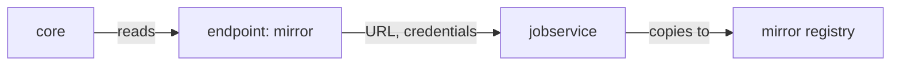

# Registry Endpoints And Providers

Before Harbor can copy anything to another registry, it has to know that the registry exists, what kind of registry it is, and how to sign in to it. This part registers the mirror in Harbor as a registry endpoint, tests it, and shows why the kind of registry matters as much as its address.

## What an endpoint holds

A **registry endpoint** is Harbor's record of one remote registry. Harbor's `core` component, its API server, stores the endpoint in Harbor's database. Every replication rule and every proxy cache project then refers to an endpoint by its name, instead of carrying its own address and password. An endpoint has these fields:

| Field | What it holds |
| --- | --- |
| Provider | The kind of registry, for example Harbor, Docker Hub or Docker registry |
| Name and description | How rules and people refer to the endpoint |
| Endpoint URL | The full address of the registry, with `http://` or `https://` and the port |
| Access ID and access secret | The user name and password, or token, that Harbor uses at the remote registry |
| Verify remote certificate | Whether Harbor checks the remote registry's TLS certificate; cleared only for a self-signed or untrusted certificate |

The **provider** is the field people underestimate. Each provider is a separate piece of code in Harbor, called an adapter, that knows how one kind of registry lists its repositories, signs in and accepts uploads. Harbor 2.15 has providers for Harbor, Docker Hub, Docker registry (that is, CNCF Distribution and anything that behaves like it), AWS Elastic Container Registry, Azure Container Registry, Google Container Registry and Google Cloud Artifact Registry, GitHub Container Registry, JFrog Artifactory, Alibaba Cloud, Huawei, Tencent and VolcEngine container registries. An endpoint with the right URL and the wrong provider fails, because Harbor speaks the wrong API to it.



The diagram shows the split of work: `core` stores the endpoint, and `jobservice`, the component that runs Harbor's background jobs, uses its URL and credentials when it copies artifacts.

## Sign the tools in

The commands in this module run in the `workstation` pod. Define a short helper for that, and a second one that calls Harbor's REST API version 2.0 as the administrator. Paste both into your terminal:

<!-- astrona:playground:renew -->

```sh
ws() { kubectl -n workstation exec -i deploy/workstation -- "$@"; }
harbor_api() {
  local method="$1" path="$2"; shift 2
  ws curl -sS -u admin:Harbor12345 -X "$method" -H 'Content-Type: application/json' \
    "https://harbor.localtest.me:8443/api/v2.0$path" "$@"
}
```

The Harbor command-line tool `harbor` keeps its own sign-in, called a credential, in a configuration file in the pod. Sign it in once, with the password read from standard input so it does not appear in the process list:

```sh
printf '%s' 'Harbor12345' | ws harbor login https://harbor.localtest.me:8443 -u admin --password-stdin
```

The command checks the user name and password against Harbor before it saves them. If it fails, check that every pod in the namespace `harbor` is running.

## Ask Harbor which providers it has

The list of providers is not only in the documentation. Harbor reports the adapters it was built with, and the provider names in that list are exactly what the API and the CLI expect in their `type` field:

```sh
harbor_api GET /replication/adapters | ws jq .
```

The answer is a JSON list of short names. Look for `docker-registry`, the provider for a plain CNCF Distribution registry such as the mirror, and for `docker-hub` and `harbor`. These names, not the longer names in the web portal, go into commands and API calls.

## Create the endpoint

Now register the mirror. It is a plain Distribution registry, so the provider is `docker-registry`. It needs no credentials, and it uses plain HTTP, so certificate verification does not apply:

```sh
ws harbor registry create --name mirror --type docker-registry \
  --url http://mirror.localtest.me:5001 --insecure \
  --description "The mirror registry"
```

Harbor's documentation says the remote registry must exist and be running when you create the endpoint, so create endpoints only for registries that answer. List the endpoints and look at the new one:

```sh
ws harbor registry list
ws harbor registry view mirror
```

The list shows one endpoint named `mirror`, with its provider and URL. The view adds its id, a number that the REST API uses to refer to it. Note that id; rules refer to the endpoint by it.

## Test the connection

An endpoint that is saved is not yet proven to work. The web portal has a **Test Connection** button for this; the same check is an API call that asks Harbor to contact the registry behind an endpoint. Replace `<MIRROR_ID>` with the id from the view:

```sh
harbor_api POST /registries/ping --data '{"id":<MIRROR_ID>}' -o /dev/null -w '%{http_code}\n'
```

The command prints `200` when Harbor's `core` component reached the mirror and the mirror answered as a registry. Any other code means Harbor could not reach it, or the provider does not match what answered. You can also run the same check before you save an endpoint, by sending the provider and URL instead of an id.

You now have a working endpoint: Harbor knows where the mirror is, which API to speak to it, and has proven it can reach it. The endpoint copies nothing by itself, though. The open question is how to tell Harbor which artifacts to copy there.

## Common pitfalls

> [!WARNING]
> - **The wrong provider with the right URL.** A Distribution registry registered as `harbor`, or Docker Hub registered as `docker-registry`, fails even though the address is right. Check the provider first.
> - **A URL without the scheme or port.** Write the full address, `http://mirror.localtest.me:5001`, not `mirror.localtest.me`. Harbor does not guess the port.
> - **Clearing certificate verification to hide a real problem.** Clear it only for a registry with a self-signed or private certificate that you trust. A certificate error against a public registry is a real error.
> - **Deleting an endpoint that rules use.** Harbor deletes only endpoints that no rule refers to. Edit the endpoint instead of deleting and recreating it.
