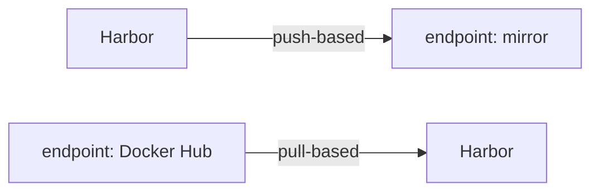

# Replication Rules, Filters And Flattening

An endpoint tells Harbor where the mirror is. It does not say which of the many artifacts in Harbor belong there, or under which name they should arrive. A **replication rule** answers both questions. This part writes a rule that copies a chosen set of tags to the mirror, runs it once, and shows how the filters and the destination path decide what arrives where.

## Push or pull

A replication rule copies in one direction. In **push-based** replication, Harbor is the source: it copies its own artifacts to the endpoint. In **pull-based** replication, the endpoint is the source: Harbor copies artifacts from it into a Harbor project. The rule's mode decides which side the endpoint is on, and so which side needs which permission.



The diagram shows the two modes: a push rule sends Harbor's artifacts out to an endpoint, and a pull rule brings an endpoint's artifacts into Harbor.

A push rule needs push permission at the endpoint; a pull rule needs only pull permission there. Harbor's `jobservice` component runs the copy in both cases. Every example in this module pushes from Harbor to the mirror.

## Filters select the artifacts

A rule without filters copies everything it can see. Filters narrow that down, and each one tests a different property of an artifact:

| Filter | What it matches |
| --- | --- |
| Name | The repository name, including the project, for example `inventory/podinfo` |
| Tag | The tag, for example `v1.0.0`; it can match or exclude |
| Label | Harbor labels attached to the artifact; it can match or exclude |
| Resource | The kind of artifact: images only, or all OCI artifacts |

Name and tag filters use the same small pattern language. `*` matches any characters except `/`, `**` matches any characters including `/` and must stand alone as a path part, `?` matches one character except `/`, and `{a,b}` matches any one of the listed alternatives. So `inventory/*` matches `inventory/podinfo` but not `inventory/tools/podinfo`, while `inventory/**` matches both. The tag filter `v*` matches `v1.0.0` and `v2`, and not `6.15.0`.

## The destination path

A copied artifact needs a name at the destination. Two settings decide it. The **destination namespace** is the first part of the path at the endpoint; when it is empty, the copy keeps the source's namespace. **Flattening** decides how many leading levels of the source path are replaced by that namespace. Here is what each choice does to `inventory/podinfo` with the destination namespace `inventory`:

| Flattening | Destination path |
| --- | --- |
| No Flattening | `inventory/inventory/podinfo` |
| Flattening 1 level (the default) | `inventory/podinfo` |
| Flatten All Levels | `inventory/podinfo` |

With a deeper source path, such as `a/b/c/d` and the namespace `ns`, the choices differ more: no flattening gives `ns/a/b/c/d`, one level gives `ns/b/c/d`, two levels give `ns/c/d`, and flattening all levels gives `ns/d`. Some registries do not allow more than two path levels, which is why flattening exists.

## A rule that copies the 6.x tags

The REST API stores a rule as a JSON object. The rule below pushes the tags of `inventory/podinfo` that start with `6.` to the mirror, under `inventory/podinfo`, and runs only when started by hand. First get the mirror's endpoint id:

<!-- astrona:playground:renew -->

```sh
harbor_api GET '/registries?page_size=100' | ws jq '.[] | {id, name, type, url}'
```

The answer lists one object for the endpoint `mirror`, with its id, provider and URL. These commands use the `ws` and `harbor_api` helpers; define them again in a new terminal. Save this as `replication-rule-copy-6x.json`, with `<MIRROR_ID>` replaced by the id:

```json
{
  "name": "copy-6x",
  "description": "Copy the 6.x tags of inventory/podinfo to the mirror",
  "dest_registry": { "id": <MIRROR_ID> },
  "dest_namespace": "inventory",
  "dest_namespace_replace_count": 1,
  "filters": [
    { "type": "name", "value": "inventory/podinfo" },
    { "type": "tag", "value": "6.*", "decoration": "matches" }
  ],
  "trigger": { "type": "manual" },
  "override": true,
  "replicate_deletion": false,
  "speed": -1,
  "enabled": true
}
```

The field `dest_namespace_replace_count` is the flattening level: `1` means one level, `0` means no flattening and `-1` means all levels. `override` lets a copy replace an artifact with the same name at the destination. `speed` is the bandwidth limit per task in kilobytes per second, and `-1` means no limit. The rule has no `src_registry`, which makes it a push rule. Send the file to Harbor:

```sh
harbor_api POST /replication/policies --data-binary @- < replication-rule-copy-6x.json -w '%{http_code}\n'
```

Harbor answers `201` when it saved the rule. The rule now exists in the web portal under **Administration**, **Replications**, and `wst harbor replication policies list` shows it too. The `harbor` CLI (version 0.0.27) draws lists and views as a table only on a terminal, so that command runs through `wst`, which adds `-t` (a terminal) to `kubectl exec`; define it with `wst() { kubectl -n workstation exec -it deploy/workstation -- "$@"; }`.

## Run it once and look at the mirror

A manual rule runs only when started. Starting a rule creates an **execution**, one run of the rule. Get the rule's id and start it, replacing `<RULE_ID>`:

```sh
harbor_api GET '/replication/policies?page_size=100' | ws jq '.[] | {id, name}'
harbor_api POST /replication/executions --data '{"policy_id":<RULE_ID>}' -w '%{http_code}\n'
```

Harbor answers `201` and `jobservice` starts copying. The mirror speaks plain HTTP, so tell `regctl` once that it must not use TLS for it, then list the tags that arrived:

```sh
ws regctl registry set mirror.localtest.me:5001 --tls disabled
ws regctl tag ls mirror.localtest.me:5001/inventory/podinfo
```

After a few seconds the list holds `6.15.0`, and not `v1.0.0`: the tag filter `6.*` let one tag through and kept the other back. The path is `inventory/podinfo`, as the flattening table predicted. If the list is empty, wait a moment and run it again; the copy runs in the background.

You can now write a rule that selects exactly the artifacts you mean and predict where they land. The rule still runs only when someone starts it, though, and you have seen only its result, not its record. How to make it run by itself, and how to read what each run did, is the open question.

## Common pitfalls

> [!WARNING]
> - **`*` where `**` was meant.** `inventory/*` does not match `inventory/team/app`. Use `**` when the repository path can have more levels.
> - **A name filter without the project.** The name filter matches the whole repository name, `inventory/podinfo`, not only `podinfo`.
> - **Doubled namespaces.** No flattening with the destination namespace `inventory` gives `inventory/inventory/podinfo`. Work out the destination path before you run the rule.
> - **Copy by chunk against a non-Harbor registry.** Harbor supports copying blobs in chunks only when both sides are Harbor. Leave it off for the mirror, Docker Hub and the other providers.
