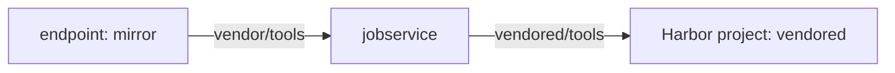

# Pull-Based Replication From A Remote Registry

Pushing is the easy direction to picture: Harbor owns the artifact and sends it away. Often the artifact lives somewhere else, and Harbor must go and get it. A supplier's image, a base image from a partner, or a build output kept in another registry all work this way. This part registers the supplier's registry as a source, creates the project that receives the copies, and writes a first pull rule.

## What changes in a pull rule

A pull rule and a push rule are the same kind of object, a replication policy. Two fields tell them apart. A push rule sets `dest_registry`, the endpoint that receives the copies. A pull rule sets `src_registry`, the endpoint the copies come from, and leaves `dest_registry` out, because the destination is this Harbor.

The filters change meaning with the direction. In a push rule, the name filter tests the names of repositories in Harbor. In a pull rule, it tests the names of repositories at the source, so it must match what the remote registry calls them, for example `vendor/tools`. The destination namespace names a Harbor project, and Harbor puts the copies in it.



The diagram shows a pull: the rule reads from the endpoint, `jobservice` copies each artifact, and the copy lands in the destination project.

A pull rule needs only read access at the source. The account stored in the endpoint must be able to list tags and pull manifests and blobs. For a registry with anonymous read access, as in this playground, no credential is needed.

## Register the source and create the project

The commands use the `ws` and `harbor_api` helpers; define them again in a new terminal. Then register the mirror as a registry endpoint with the provider `docker-registry`, which is the provider for a plain CNCF Distribution registry:

<!-- astrona:playground:renew -->

```sh
ws() { kubectl -n workstation exec -i deploy/workstation -- "$@"; }
harbor_api() {
  local method="$1" path="$2"; shift 2
  ws curl -sS -u admin:Harbor12345 -X "$method" -H 'Content-Type: application/json' \
    "https://harbor.localtest.me:8443/api/v2.0$path" "$@"
}
ws harbor login https://harbor.localtest.me:8443 -u admin -p Harbor12345
ws harbor registry create --name mirror --type docker-registry --url http://mirror.localtest.me:5001 --insecure
```

`--insecure` clears the "Verify Remote Cert" check, which the plain-HTTP mirror needs. A real remote registry uses HTTPS and keeps the check on. Look at what the mirror holds before you copy anything, so you can predict the result:

```sh
ws regctl registry set mirror.localtest.me:5001 --tls disabled
ws regctl repo ls mirror.localtest.me:5001
ws regctl tag ls mirror.localtest.me:5001/vendor/tools
```

The mirror has two repositories, `vendor/debug` and `vendor/tools`. The tags of `vendor/tools` are `1.0.0`, `1.1.0` and `nightly`. Create the destination project, a private one named `vendored`:

```sh
ws harbor project create vendored --storage-limit -1
```

Create the project before the rule. A rule can name a destination project that does not exist yet, and Harbor may create it during the run, but a project you create yourself has the visibility, quota and members you chose.

## Write the pull rule

Save this as `replication-rule-pull-tools.json`, with `<MIRROR_ID>` replaced by the endpoint's id from `harbor_api GET /registries`:

```json
{
  "name": "pull-tools",
  "description": "Pull vendor/tools from the mirror",
  "src_registry": { "id": <MIRROR_ID> },
  "dest_namespace": "vendored",
  "dest_namespace_replace_count": 1,
  "filters": [
    { "type": "name", "value": "vendor/tools" }
  ],
  "trigger": { "type": "manual" },
  "override": true,
  "replicate_deletion": false,
  "deletion": false,
  "speed": -1,
  "enabled": true
}
```

The name filter `vendor/tools` names one repository at the source. The destination namespace `vendored` with one level of flattening replaces the first path level, `vendor`, so the copy of `vendor/tools` becomes `vendored/tools`. The trigger is manual for now. Send the rule to Harbor and start it:

```sh
harbor_api POST /replication/policies --data-binary @- < replication-rule-pull-tools.json -w '%{http_code}\n'
harbor_api POST /replication/executions --data '{"policy_id":<RULE_ID>}' -w '%{http_code}\n'
```

Harbor answers `201` to both. The rule's id comes from `harbor_api GET /replication/policies`. After a few seconds, list what arrived:

```sh
harbor_api GET '/projects/vendored/repositories?page_size=100' | ws jq -r '.[].name'
harbor_api GET '/projects/vendored/repositories/tools/artifacts?with_tag=true' | ws jq -r '.[] | .tags[]?.name'
```

The project holds the repository `vendored/tools`, and its tags are `1.0.0`, `1.1.0` and `nightly`, because the rule has no tag filter. The repository `vendor/debug` did not come, because the name filter selected only `vendor/tools`.

You can now bring artifacts from a remote registry into a Harbor project and predict the path they arrive under. The rule still copies every tag, including the moving `nightly`, and it runs only when you start it; the next parts fix both.

## Common pitfalls

> [!WARNING]
> - **Writing the filter with Harbor's names.** In a pull rule the name filter matches the names at the source. `vendored/tools` selects nothing at the mirror.
> - **Setting `dest_registry` on a pull rule.** A rule with both endpoints is a different kind of rule. A pull rule sets only `src_registry`.
> - **Forgetting the flattening level.** With no flattening, `vendor/tools` arrives as `vendored/vendor/tools`.
> - **Using the wrong provider for the source.** A plain Distribution registry needs `docker-registry`. The provider `harbor` makes Harbor call APIs the registry does not have.
