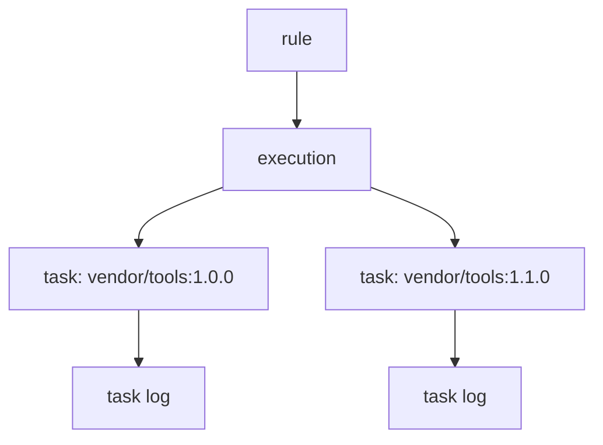

# Why Executions Fail And How To Recover

Replication works in the background, so a failure is quiet. The rule exists, the schedule fires, and the artifact still does not arrive. This part lists the causes that fail a pull or a push, shows where each one appears, and describes how to recover without recreating the rule.

## Where a failure shows up

A run is an execution, and each artifact in it is a task. An execution has one of these statuses: `InProgress`, `Succeed`, `Failed` or `Stopped`. A task has the same statuses. The execution's status is `Failed` when at least one of its tasks failed, so the execution list tells you that something went wrong, and the task list tells you what.

An execution can also end with `Succeed` and no tasks. That happens when the filters matched nothing, or when everything the filters matched already existed at the destination. It is not an error, and it is the first thing to rule out when "nothing arrived".



The diagram shows that one execution holds one task for each artifact, and each task has its own log.

## Causes and their signs

Most failures belong to one of these causes. The sign is what you read in the task log or in the endpoint health.

| Cause | Sign |
| --- | --- |
| The source or destination registry is down or unreachable | The task fails quickly, and the log names a connection error or a timeout |
| The credential is wrong or expired | The log names an unauthorized or forbidden response from the remote registry |
| The endpoint has the wrong provider or URL | The ping of the endpoint fails |
| The remote certificate is not trusted | The log names a certificate error. For a lab registry, clear the certificate verification; for a real registry, fix the trust |
| The destination project has a quota that is full | The task fails when it writes the blobs, and the log names the quota |
| The destination tag is protected by an immutability rule | The task fails, or the tag is skipped, because Harbor refuses to overwrite it |
| The destination project does not exist and cannot be created | The task fails at the start of the copy |

Read the execution status and the failed tasks:

<!-- astrona:playground:renew -->

```sh
ws() { kubectl -n workstation exec -i deploy/workstation -- "$@"; }
harbor_api() {
  local method="$1" path="$2"; shift 2
  ws curl -sS -u admin:Harbor12345 -X "$method" -H 'Content-Type: application/json' \
    "https://harbor.localtest.me:8443/api/v2.0$path" "$@"
}
harbor_api GET '/replication/executions?policy_id=<RULE_ID>&page_size=5' | ws jq '.[] | {id, status, trigger, succeed, failed, in_progress}'
harbor_api GET /replication/executions/<EXECUTION_ID>/tasks | ws jq '.[] | {id, status, src_resource, dst_resource}'
```

The commands need a rule from the earlier parts. The first command lists the five most recent executions of one rule, with the counts of tasks that succeeded, failed and are still running. The second lists the tasks of one execution, with the source and destination of each. Then read the log of a failed task, using the id from the task list:

```sh
harbor_api GET /replication/executions/<EXECUTION_ID>/tasks/<TASK_ID>/log
```

The log is the text `jobservice` wrote while it copied, including the error the remote registry returned.

## Cause one: the source is down

Make the failure happen to see it. Stop the mirror, start the rule, and read the task. Scale the mirror down:

```sh
kubectl -n mirror scale deployment mirror --replicas=0
harbor_api POST /replication/executions --data '{"policy_id":<RULE_ID>}' -w '%{http_code}\n'
```

Harbor accepts the start with `201`, because starting an execution does not check the source. After a short wait, the execution has the status `Failed`, and the failed task's log names the connection error to `mirror.localtest.me:5001`. The endpoint's ping would fail as well:

```sh
harbor_api POST /registries/ping --data '{"id":<MIRROR_ID>}' -o /dev/null -w '%{http_code}\n'
```

A healthy endpoint answers `200`; an unreachable one answers an error status. Bring the mirror back and start the rule again:

```sh
kubectl -n mirror scale deployment mirror --replicas=1
kubectl -n mirror rollout status deployment/mirror
harbor_api POST /replication/executions --data '{"policy_id":<RULE_ID>}' -w '%{http_code}\n'
```

The new execution succeeds. The rule itself never needed a change: a failed execution does not disable a rule, and the next scheduled run retries without help.

## Recover without recreating

The fix depends on the cause, but the pattern is the same. Fix the endpoint or the destination in place, then start a new execution. Edit the endpoint with `PUT /registries/<ID>` or the web portal, free quota or adjust the immutability rule, and start the rule by hand to confirm. Do not delete the rule to "reset" it: its history of executions and logs is the evidence you use to find the cause.

Two limits are worth knowing. Harbor refuses to edit or delete a rule while one of its executions is running, so wait or stop the execution first. And a stopped execution does not undo the tasks that finished: the artifacts already copied stay.

You now know where replication failures appear, which causes to check, and how to recover without losing the history. Together with the earlier parts, you can build a pull rule, keep it current on a schedule, and diagnose it when it stops working.

## Common pitfalls

> [!WARNING]
> - **Reading `Succeed` as "copied".** An execution with zero tasks also succeeds. Check the task list.
> - **Deleting and recreating the rule.** You lose the logs that name the cause.
> - **Fixing the rule when the endpoint is the problem.** Run the endpoint's ping first.
> - **Forgetting to scale the mirror back.** Later steps of the playground, and its checks, assume it runs.
