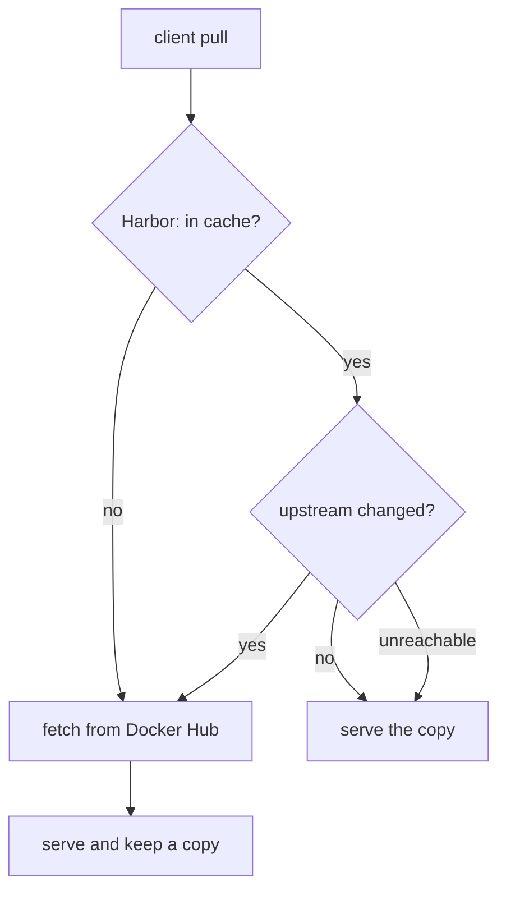

# Why Cache A Remote Registry

Pulling a public image looks free and instant, until many machines do it at once. This part explains the three problems a cache in front of a public registry solves, which registries Harbor can cache, and the rules Harbor follows when it decides whether to serve its copy or fetch a new one.

## Three problems with pulling straight from Docker Hub

The first problem is the **rate limit**. Docker Hub limits how many image pulls an anonymous user can make in a time window. Docker's documentation gives the number per IP address, about 100 pulls every 6 hours for anonymous users at the time of writing, and Docker changes it from time to time. A cluster behind one network address shares that limit across all its nodes and build machines. When it runs out, every pull fails until the window moves on.

The second problem is **traffic and time**. The same layers of `alpine` or `nginx` cross the internet for every node that needs them. Each pull costs bandwidth and adds seconds to every rollout.

The third problem is **availability**. If Docker Hub is slow or down, every pull that needs it stops, including the ones for images you have pulled a hundred times before.

## What the cache does

A **proxy cache project** is a Harbor project tied to one registry endpoint. Clients pull through it with Harbor's address and the project name in front of the image path. Harbor's `core` component then decides what to serve:



The diagram shows Harbor's decision for each pull: fetch on a miss, serve the copy when the upstream is unchanged or unreachable, and fetch again when the upstream changed.

Harbor's documentation spells out four cases. If the upstream image has not changed, Harbor serves its copy. If it has changed, Harbor pulls the new version, serves it and caches it. If the upstream registry cannot be reached, Harbor serves its copy. If the image no longer exists upstream, Harbor serves nothing. For Docker Hub, Harbor checks for changes with `HEAD` requests, which do not count against the rate limit; only pulling changed layers does.

## Which registries can be cached

A proxy cache project uses a registry endpoint, so the list of providers decides what can be cached. Harbor 2.15's proxy cache documentation lists Harbor, Docker Hub, Docker registry (CNCF Distribution), AWS Elastic Container Registry, Azure Container Registry, Google Container Registry, Quay, GitHub Container Registry and JFrog Artifactory. You need one proxy cache project per upstream registry.

Look at what your playground already has. Define the helpers, then list the projects and the registry endpoints:

<!-- astrona:playground:renew -->

```sh
ws() { kubectl -n workstation exec -i deploy/workstation -- "$@"; }
harbor_api() {
  local method="$1" path="$2"; shift 2
  ws curl -sS -u admin:Harbor12345 -X "$method" -H 'Content-Type: application/json' \
    "https://harbor.localtest.me:8443/api/v2.0$path" "$@"
}
harbor_api GET /projects | ws jq '.[] | {name, registry_id}'
harbor_api GET '/registries?page_size=100' | ws jq 'length'
```

The playground has the projects `library` (Harbor creates it at installation) and `inventory`, and neither has a `registry_id`: they are normal projects. There are no registry endpoints yet, so the count is `0`. A proxy cache project is the one kind of project whose `registry_id` points at an endpoint.

One more check shows that the cluster can reach Docker Hub at all. The workstation sends one request to Docker Hub's web address:

```sh
ws curl -sS -o /dev/null -w '%{http_code}\n' https://hub.docker.com
```

A `200` or a redirect code such as `301` means the internet path works. A timeout means the cache cannot work either, because Harbor needs the same path.

You now know what a proxy cache solves and how Harbor decides what to serve. Nothing in the playground is cached yet; building the endpoint and the project is the next step.

## Common pitfalls

> [!WARNING]
> - **Thinking a cache removes the rate limit.** It reduces the pulls that reach Docker Hub. The first pull of every image, and every changed layer, still counts.
> - **Expecting the cache to keep an image that was deleted upstream.** When the image is gone from the upstream registry, Harbor serves nothing for it.
> - **One project for several upstreams.** A proxy cache project uses exactly one registry endpoint. Docker Hub and GitHub Container Registry need two projects.
