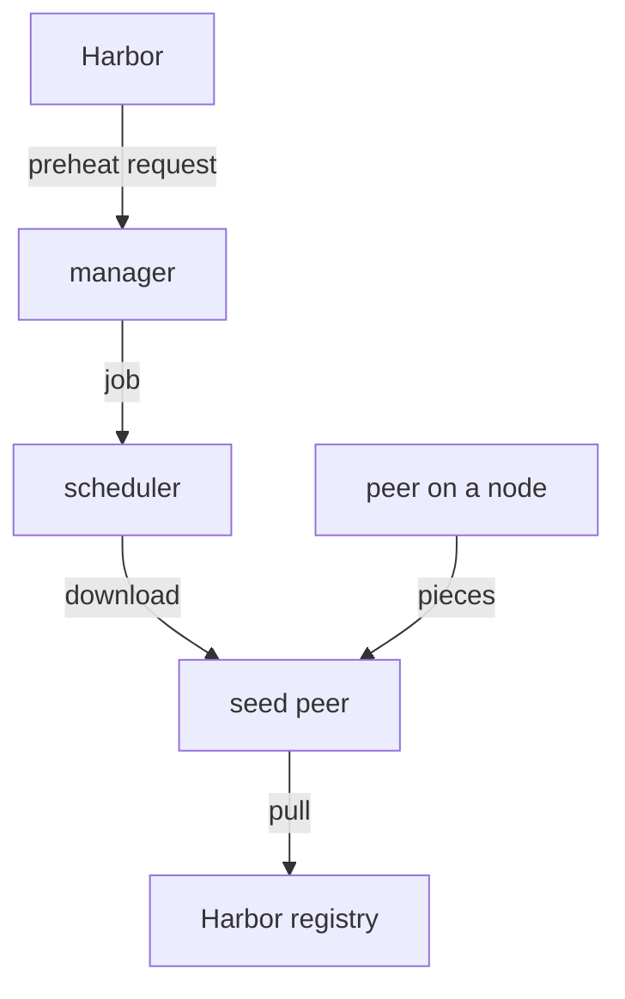

# P2P Distribution And Dragonfly

Before you connect Harbor to a P2P engine, you need to know what the engine does and which of its parts Harbor talks to. This part explains P2P distribution and preheating, the parts of Dragonfly, and how they fit together, and then looks at the Dragonfly running in your playground.

## The problem: many nodes, one registry

When a new image rolls out, every node that runs it pulls the same layers. Without help, all of those pulls go to the registry. A layer of 100 MB pulled by 100 nodes is 10 GB leaving the registry at once. The registry's network link and disks set the speed of the whole rollout, and a slow registry stalls every node.

**Peer-to-peer (P2P) distribution** splits each layer into pieces and lets nodes fetch pieces from each other. Only a few copies of each piece come from the registry; the rest come from neighbours. The more nodes take part, the less work falls on the registry.

**Preheating** removes the first wait too. Instead of waiting for the first node to ask for a new image, the P2P engine fetches it as soon as it is released and holds it ready. When the rollout starts, the pieces are already in the P2P network.

## The parts of Dragonfly

Dragonfly version 2 has four parts. Each one has a single job:

| Part | What it does |
| --- | --- |
| Manager | The control service. It keeps the configuration of Dragonfly clusters, offers the REST API on port `8080` and the web console, and accepts preheat jobs |
| Scheduler | Decides, for each download, which peers a node should fetch each piece from |
| Seed peer | A peer that downloads from the registry first. Preheating sends images to the seed peers |
| Peer (client) | Runs on each node as `dfdaemon` and fetches pieces from other peers and seed peers; the container runtime pulls through it |



The diagram shows a preheat: Harbor sends a request to the manager, the manager turns it into a job, the scheduler hands the download to a seed peer, the seed peer pulls the image from Harbor, and the peers on the nodes later fetch the pieces from it.

Harbor talks only to the **manager**, at its REST address. Everything after that happens inside Dragonfly. Harbor 2.12 and later work with Dragonfly 2.1.59 and later. Harbor can also use **Kraken**, a P2P engine from Uber, as a provider; Dragonfly version 1 is archived and should not be used for new installations.

## Look at your Dragonfly

The playground runs a small Dragonfly: one manager, one scheduler and one seed peer, with MySQL and Redis for the manager. There is no peer on the node, because the `kind` node does not pull through Dragonfly here. List the pods:

<!-- astrona:playground:renew -->

```sh
kubectl -n dragonfly-system get pods
```

The list shows the manager, the scheduler and the seed peer, plus `mysql` and `redis`, all running. Harbor will reach the manager at its Service address inside the cluster. Check from the workstation pod that the manager answers there; this is the address you will give Harbor:

```sh
kubectl -n workstation exec deploy/workstation -- \
  curl -sS -o /dev/null -w '%{http_code}\n' http://dragonfly-manager.dragonfly-system.svc.cluster.local:8080/healthy
```

The manager answers `200` on its health endpoint. The scheduler and the seed peer register themselves with the manager; you can see them in the manager's log:

```sh
kubectl -n dragonfly-system logs deploy/dragonfly-manager --tail=20
```

The log lines record the manager's start-up and the connections from the scheduler and the seed peer. If the manager is restarting, it usually could not reach MySQL or Redis yet; it recovers once they are ready.

You now know what P2P distribution and preheating do, what each Dragonfly part is for, and which address Harbor needs. Harbor still does not know this Dragonfly exists; registering it is the next step.

## Common pitfalls

> [!WARNING]
> - **Pointing Harbor at the scheduler or a seed peer.** Harbor sends preheat requests only to the manager's REST address, port `8080`.
> - **Expecting preheating to help without peers on the nodes.** Preheating fills the seed peers. Nodes benefit only when their container runtime pulls through a Dragonfly peer.
> - **Choosing Dragonfly version 1.** It is archived, and version 2 cannot work with it. Harbor 2.12 and later need Dragonfly 2.1.59 or later.
